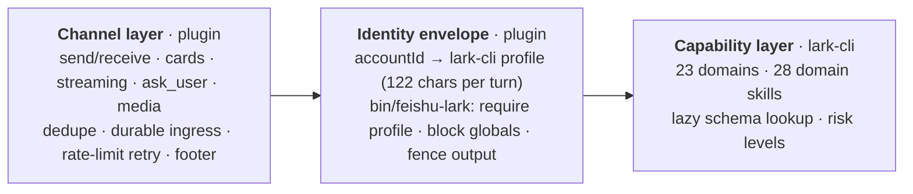

<h1 align="center">openclaw-lark-2</h1>

<p align="center"><b>Feishu / Lark channel plugin · native OpenClaw 2.0</b></p>

<p align="center">
  Forked from Feishu's official <code>@larksuite/openclaw-lark</code>. Upstream stopped at OpenClaw 1.x — this project finishes that road and takes it one step further:<br/>
  <b>native 2.0 · 23 Feishu domains · one gateway serving several Feishu bots.</b>
</p>

<p align="center"><sub>In one line: capability belongs to lark-cli; identity and channel belong to the plugin.</sub></p>

<p align="center">
  
  
  
  
  
  
</p>

<p align="center"><sub><a href="./README.md">中文</a> · <b>English</b></sub></p>

## Important

> [!IMPORTANT]
> **2026.10.10 is a breaking refactor.** Upgrading from a version before 2026.10.10? Read [Migrating from before 2026.10.10](#migrating-from-before-20261010) first — it covers the capability-consent step triggered by the tool-list change.

## Table of Contents

- [Three-way comparison](#three-way-comparison)
- [Rich text and interactive buttons](#rich-text-and-interactive-buttons)
- [Architecture](#architecture)
- [Quick start](#quick-start)
- [Configuration](#configuration)
- [Migrating from before 2026.10.10](#migrating-from-before-20261010)
- [Changelog](#changelog)

---

## Three-way comparison

| Dimension | **openclaw-lark-2** | **@openclaw/feishu** (OpenClaw) | **@larksuite/openclaw-lark** (Feishu) |
|---|:---:|:---:|:---:|
| Origin | fork of Feishu's `@larksuite/openclaw-lark` 2026.7.16, rewritten for 2.0 | OpenClaw in-house | Feishu open source (abandoned by the official team after 2026.7.16) |
| OpenClaw 2.0 | **✅ native 2.0 SDK** | ✅ native 2.0 | ❌ 1.x `loadConfig`, cannot load |
| Domain coverage (Feishu ops) | **23 domains (lark-cli wired end to end)** | ~6 domains | 10 domains |
| Per-turn tool cost | **1 tool / 479 chars ≈ 0.14k tokens** | 14 tools / ≈15–20k chars ≈ **4–6k tokens** (est.) | 39 tools / ≈65–70k chars ≈ **18–21k tokens** (est.) |
| Delivery | **CLI on demand + 28 domain skills** | resident tools | resident tools |
| Upgrade path | **plugin and capability decoupled — upgrade either, anytime** | tied to plugin releases | tied to plugin releases |
| Multi-bot / multi-account | **✅ plugin ↔ lark-cli end to end: one profile per account, enforced on every call** | ✅ `accountId` param | ✅ in-plugin `accounts` config |
| Wrong-account protection | **✅ fails without a profile** | ⚠️ caller's job | ❌ |
| User authorization | **✅ in-chat card + `feishu_auth`** | ❌ | ✅ |
| exec output fencing | **✅ wrapper** | — | — |
| Group streaming card | **✅** | ✅ | ❌ static by default |
| Multi-image post | **✅ default** | ❌ | ❌ |
| `ask_user` button card | **✅** | ❌ | ❌ |
| Tool-step display | **✅ in-card blocks, on by default (no `/verbose` needed)** | ⚠️ `/verbose` text echo only | ⚠️ `/verbose` text echo only |
| Diagnostics | **✅ `/feishu doctor`, `/feishu larkcli status`** | ✅ | ⚠️ |
| Tests | **✅ 62 files / 495 cases** | ✅ 99 files / 1202 cases | ❌ none |

> [!NOTE]
> Token figures are the per-turn tool-schema payload: measured for this plugin (`scripts/check-tools.js`), estimated for the two official ones from tool count and parameter-definition size (~1–1.8 KB schema per tool).

### Details

#### OpenClaw 2.0

Upstream is stuck on the 1.x `loadConfig` plugin API; 2.0 replaced the plugin model, so upstream code **cannot load**. This project is a native 2.0 implementation, not just "it runs":

| 2.0 mechanism | How this plugin uses it |
|---|---|
| Plugin entry | `register()` + `runtime.config.current()` |
| Tools / commands | `registerTool`, `registerCommand` |
| Per-turn context | `agentPrompt.inboundFormattingHints({cfg, accountId})` (`alwaysActive` is a no-op on 2.0) |
| Channel message actions | implements `feishuMessageActions`, wired into core's `message` tool |
| Card interactions | full `card.action.trigger` chain (`ask_user` buttons, inject_prompt) |
| Host primitives | `plugin-sdk/*` (344 subpaths since 10.2): durable ingress, thread bindings, webhook, retry |

#### Domain coverage

The 23 domains come from lark-cli (docs / sheets / base / drive / im / task / calendar / wiki / contact / approval / mail / minutes / vc / okr / slides / whiteboard / markdown / mindnotes / note / event / attendance / apps / application) with 28 domain skills loaded on demand. `@openclaw/feishu` ships 14 tools over doc / drive / wiki / chat / perm / bitable — **no calendar, task or sheets**.

Channel side is a different tier too:

| Channel capability | This plugin | `@openclaw/feishu` |
|---|---|---|
| Inbound converters | **22 kinds** | partial |
| Group streaming card | **✅ `replyMode.group:"streaming"`** | ✅ |
| Multi-image merged post | **✅ default** | ❌ one by one |
| `ask_user` button card | **✅ button + free-form answer + all group members** | ❌ text fallback |
| Tool-step display | **✅ in-card blocks, on by default** | ⚠️ `/verbose` / preview text echo only |
| Durable ingress queue | **✅ opt-in** | ✅ default on |
| Full egress SSRF guard | **✅ DNS pinning + private-net block + redirect checks** | ✅ CardKit/registration only |

#### Multi-bot / multi-account

lark-cli is **single-profile**: `profile use` flips process-global state, one Feishu app at a time. So one gateway serving several Feishu bots is impossible with the CLI alone. This plugin adds three layers:

1. account ↔ profile **per call** (`--profile <account>`, not a global switch);
2. the conversation's account is injected into context every turn (122 chars), so the model never guesses;
3. `bin/feishu-lark` enforces it at the command line: no profile → fail, global commands refused, stdout fenced.

#### Upgrade path

Capability lives in the CLI: new domains and commands arrive with lark-cli upgrades; the plugin changes only when channel or identity logic changes. **Neither side waits for the other.**

---

## Rich text and interactive buttons

OpenClaw core has a **channel-agnostic** rich-text protocol, `MessagePresentation`:
`/status` emits a `table` block ("Session status", two columns), and approvals,
`ask_user` and provider login emit `buttons` blocks. Core adapts those blocks
to the capabilities the channel declares (`presentationCapabilities`) and then
calls the channel's `renderPresentation` hook. **A channel that declares no
capabilities gets every one of them downgraded to plain text.**

This plugin declares and implements that protocol, so Feishu now renders what
Telegram renders:

| Portable block | Feishu card element |
|---|---|
| `text` | `markdown` |
| `context` | `markdown` with `text_size: notation` (low emphasis) |
| `divider` | `hr` |
| `table` | `markdown` holding a GFM table (Feishu draws it as a real table) |
| `buttons` | `column_set` → `column` → `button` |
| `select` | the same, one button per option (Feishu has no native menu control) |
| `chart` | no native chart element, so core downgrades it to text |

Modules:

- `src/card/presentation-card.js` — portable blocks → Feishu Card JSON 2.0
  (pure functions, unit-tested).
- `src/card/presentation-delivery.js` — reply payload → card + accompanying text.
- `src/messaging/outbound/outbound.js` — declares `presentationCapabilities` and
  implements `renderPresentation`.

### Command argument menus

The **choices** for commands like `/verbose`, `/think` and `/fast` are owned by
core (`commands-registry`); the channel only renders them. Telegram renders them
as an inline keyboard. Feishu has no native command registration, so the plugin
parses the inbound command, resolves the candidate menu and renders a card:

- every button's `value` is `{ action: "inject_prompt", prompt: "/verbose on" }`;
- clicking it injects that command text as a user message and goes through the
  normal command pipeline (`handleInjectPromptAction` in
  `src/channel/event-handlers.js`);
- therefore authorization, auditing and persistence all stay on core's existing
  path — the plugin keeps no command state of its own.

Module: `src/channel/command-menu.js`.

### Model picker

Core drives the model picker and asks the channel for buttons through the
`ChannelCommandAdapter` hooks. This plugin implements all five of them
(`src/channel/model-menu.js`); the buttons use `inject_prompt` too:

| Button | Injected command |
|---|---|
| Browse providers | `/models providers` |
| A provider | `/models <provider>` |
| A model | `/model <provider>/<model> -s` (session scope, the same scope the Telegram picker applies) |
| Pagination | `/models <provider> <page>` |

---

## Architecture



---

## Quick start

Requirements: OpenClaw ≥ 2026.8.1, `lark-cli` (`npm i -g @larksuite/cli`), exec enabled for the agent.

```bash
openclaw plugins install clawhub:@mirr0ch1/openclaw-lark-2 --accept-capabilities
openclaw config set channels.feishu.appId cli_xxx
openclaw config set channels.feishu.appSecret xxx
# then in Feishu: /feishu larkcli sync   (idempotent; adopts existing profiles)
#                  /feishu larkcli status
```

---

## Configuration

```jsonc
{
  "channels": {
    "feishu": {
      "appId": "cli_main",
      "appSecret": "xxx",
      "accounts": {
        "plaud":     { "appId": "cli_a", "appSecret": "xxx" },
        "hdwriting": { "appId": "cli_b", "appSecret": "xxx" }
      },
      "larkCli": {
        "enabled": "auto",     // auto (default) | true | false
        "prompt": "minimal",   // minimal (default) | compact | full | off
        "binaryPath": ""
      }
    }
  }
}
```

> [!NOTE]
> Account id doubles as the lark-cli profile name; if that appId is already bound under another name the plugin adopts it (lark-cli forbids two profiles per appId).

---

## Migrating from before 2026.10.10

2026.10.10 collapsed the registered tools from 38 to 1 (`feishu_auth`); business capability moved to lark-cli. Two steps after upgrading.

### 1. Handle the capability-consent warning

The plugin's declared surface changed (tool list 38 → 1), so OpenClaw asks for consent again. When you see:

```text
Plugin "openclaw-lark-2" requires capability consent; disable and re-enable it
or run: openclaw plugins enable openclaw-lark-2 --accept-capabilities
```

accept once:

```bash
openclaw plugins enable openclaw-lark-2 --accept-capabilities
```

In Feishu: `/plugins enable openclaw-lark-2 --accept-capabilities`.

- **ClawHub / npm installs** record artifact integrity, so an upgrade can accept in one step: `openclaw plugins update openclaw-lark-2 --accept-capabilities`.
- **Local path / archive installs** carry no integrity record, so OpenClaw cannot prove the new bytes are what you approved — **every replacement needs a fresh confirmation**.

### 2. Drop the stale tool allow-list

Remove `feishu_*` entries from `agents.*.tools.alsoAllow` (entries in `tools.deny` are harmless).

### 3. Where the tools went

| Old tool | Now |
|---|---|
| `feishu_create_doc` / `fetch_doc` / `update_doc` | `feishu-lark --profile <p> docs +create / +fetch / +update` |
| `feishu_bitable_*` / `calendar_*` / `task_*` | `feishu-lark … base / calendar / task …` |
| `feishu_im_user_*` | `feishu-lark … im +messages-search / +chat-messages-list` |
| `feishu_im_user_message` | `feishu-lark … im +messages-send` (or core `message` tool as bot) |
| `feishu_drive_file` / `sheet` / `wiki_*` / `get_user` / `chat*` | `feishu-lark … drive / sheets / wiki / contact / im …` |
| `feishu_oauth` / `oauth_batch_auth` | **`feishu_auth`** (the only remaining tool) |

The `feishu-cli` skill carries the routing table; details come from `lark-cli <domain> --help` or `lark-cli skills read lark-<domain>`.

---

## Changelog

<details open>
<summary><b>2026.10.13</b> · 2026-10-27 · Rich text and interactive buttons: /status draws a table, /verbose gets buttons</summary>

The Feishu channel only had plain text and the `ask_user` card, because the
plugin never declared OpenClaw's **portable rich-text protocol**
(`MessagePresentation`). Core downgraded every `table` / `buttons` block to text
before delivery. This release wires the protocol up.

**Portable rich text**

- Declares `presentationCapabilities` (`tables` / `buttons` / `selects` /
  `context` / `divider` on, `charts` off so core downgrades them) and implements
  `renderPresentation`.
- New `src/card/presentation-card.js`: portable blocks → Feishu Card JSON 2.0.
  A `table` becomes a GFM table inside the card (Feishu draws it as a real
  table); `buttons` / `select` become `column_set` → `column` → `button` (v2 has
  no v1 `action` wrapper).
- New `src/card/presentation-delivery.js`: reply payload → card + accompanying
  text. When the payload carries `presentationTextMode: "fallback"` (the text is
  the fallback copy of the presentation) the text is no longer sent twice.
- Wired into all three delivery paths: core outbound `sendPayload`, inbound
  command replies (where `/status` lands) and inbound agent replies (approval
  and provider-login buttons).
- Code-built cards travel as `channelData.feishu.nativeCard`, bypassing the
  model-authored card sanitiser, so they keep full element fidelity.

**Command argument menus**

- New `src/channel/command-menu.js`: resolves the candidate menu for `/verbose`,
  `/think`, `/fast` and friends through core's `commands-registry` and renders
  it as a card.
- Button values are `{ action: "inject_prompt", prompt: "/verbose on" }`; a click
  injects the command text as a user message. This reuses the plugin's existing
  `inject_prompt` mechanism and adds no command state, so authorization and
  auditing stay on core's path.
- The menu is only offered to senders who may run commands, and a command whose
  argument is already given (`/verbose on`) does not open a menu.

**Model picker**

- New `src/channel/model-menu.js` implements core's five `ChannelCommandAdapter`
  model-picker hooks (the button source for `/model` and `/models`). The buttons
  use `inject_prompt` as well, and core performs the selection
  (`/model <provider>/<model> -s`, session scope — the same scope the Telegram
  picker applies).

**Tests**

- 5 new test files (portable blocks → card, payload → card resolution, command
  argument menu, model picker, undefined-identifier guard), 40 cases; the full
  suite is **67 files / 538 cases** and passes.

**Regression fixes**

- Fixed an accident introduced by this same branch: the command-menu block
  referenced `effectiveSessionKey` — a local of `dispatchNormalMessage` /
  `dispatchCommentMessage` / `dispatchSyntheticMessage`, not of
  `dispatchToAgent`. **Every command message** (`/status`, `/stop`, `/verbose`,
  …) therefore threw a `ReferenceError` before it could dispatch or send
  anything, so Feishu showed neither a reply nor an error; ordinary messages
  skipped the block and still worked. The session key is now resolved the same
  way the other dispatch paths do: `dc.threadSessionKey ?? dc.route.sessionKey`.
- New `scripts/check-undef.js` + `tests/channel/no-undefined-identifiers.test.ts`:
  a `tsc --checkJs` pass filtered to undefined-identifier diagnostics (TS2304 and
  friends) over every `src/**/*.js`, so this class of accident is caught before
  it ships. Verified red against the broken version.
- New `scripts/link-openclaw.js` + `postinstall`: `npm install` deletes the
  hand-made `node_modules/openclaw` symlink (openclaw is the host program, not
  a registry dependency), which broke every `require('openclaw/plugin-sdk/...')`
  in standalone runs. The hook restores it.
- A failed card send no longer swallows the reply: system-command replies fall
  back to plain text, agent replies fall back to the visible text, and the
  command menu falls back to running the command itself.

</details>

<details open>
<summary><b>2026.10.11</b> · 2026-10-25 · Docs fix: comparison table and English wording</summary>

No code changes. Fixes factual slips in the README and reconnects the two languages:

- Comparison table, multi-bot / multi-account: `@larksuite/openclaw-lark` **does support it** (in-plugin `accounts` config) and was wrongly marked ❌. This project's difference is only the account ↔ lark-cli profile binding, enforced on every call.
- Comparison table, tool-step display: the two right-hand cells only said `verbose`, which hid the difference. They now state it — in-card blocks, on by default here; `/verbose` text echo for the two official plugins.
- The English "fork of Feishu 7.16" now names `@larksuite/openclaw-lark` 2026.7.16 explicitly, so it cannot be confused with OpenClaw's built-in `@openclaw/feishu`.
- Restored the `中文 · English` switcher, and synced the badges and the comparison row to **62 files / 495 tests**.

</details>

<details>
<summary><b>2026.10.10</b> · 2026-10-25 · Big refactor: tool surface 38 → 1, business capability delegated to lark-cli</summary>

This release does not add features; it redraws the boundary: **the plugin owns the channel and the identity, lark-cli owns the business capability.**

**Tool surface (breaking)**

- Registered tools **38 → 1**: only `feishu_auth` (in-chat device-flow authorization) remains. 37 removed: doc×3 (taking the whole remote MCP transport with them), bitable×5, calendar×4, task×7, im read×3, doc search×1, drive×3, sheets×1, wiki×2, contact×2, chat×2, media×2, `im_user_message`, `oauth`, `oauth_batch_auth`.
- Per-turn tool schema **67,206 → 479 characters** (−99.3%); `src/tools` **12,098 → 662 lines** (−94%).
- `contracts.tools` / `toolMetadata` in `openclaw.plugin.json` recomputed from the live registrations; `TOOL_SCOPES` emptied (the channel's own `REQUIRED_APP_SCOPES` stays).

**Identity envelope (new)**

- `bin/feishu-lark`: `--profile` enforced per call (missing → hard failure; a single-profile install adopts it automatically), process-global subcommands rejected (`profile use/add/remove`, `config bind`, `lark-cli update`), stdout fenced as `EXTERNAL_UNTRUSTED_CONTENT` by default (`--no-fence` for jq/python).
- `src/larkcli/profiles.js`: account ↔ profile mapping (appId-first resolution, reuses existing bindings), `provisionProfiles` (idempotent, secret over stdin, backs up before writing, heals `not_configured`), `healthCheck` (detects appId drift).
- `inboundFormattingHints` injects the identity every turn: `minimal` (default, 122 chars) / `compact` / `full` / `off`.

**Authorization**

- The plugin's own UAT stack (`oauth` / `auto-auth` / `oauth-cards` / `onboarding-auth` / `device-flow` / `token-store` / `uat-client`) removed entirely; `/feishu auth` now prints the authorization walkthrough, and the user-authorization section of `/feishu doctor` reports lark-cli profile state.
- New `feishu_auth`: `authorize` sends a button card carrying the authorization link → `complete` finishes the flow with `--device-code`; `status` / `revoke` map to `auth status` / `auth logout`.

**Skills**

- 8 → 3: new `feishu-cli` (identity rules + domain routing table + high-risk / cross-session read rules + output parsing); five thin pointers removed.

**Config**

- New `channels.feishu.larkCli` (`enabled` / `prompt` / `binaryPath`); `mcpEndpoint` / `mcp_url` removed together with the MCP transport.

**SDK deprecation adaptation**

- The session-level `/verbose` override now goes through the async reader `getSessionEntryAsync` (the synchronous `getSessionEntry` keeps working through 2026-12-31 and is removed in the first January 2027 stable release); an inline `/verbose` short-circuits before any store read; a core without the async reader is treated as "no session override" and falls back to the configured default.
- The conversation binding manager now prefers **V2** (`createAccountScopedConversationBindingManagerV2`: worker-backed async reads/writes plus the current-source assertion). Cores before 2026.10.10 ship no V2 at all, so they fall back to the legacy factory with a single debug log; that fallback disappears once the peer floor reaches 10.10.
- Behaviour and storage formats are unchanged — only the read/write paths moved. After publishing, the session entry in the ClawHub deprecation audit should clear; the bindings entry stays until the fallback is removed.

**Testing and self-checks**

- The third layer of `scripts/check-tools.js` is now a CLI-delegation smoke test (binary, wrapper, per-account profile health).
- **62 files / 495 tests**, including this round's tool-use resolution cases and the two-generation manager coverage.

</details>

<details>
<summary><b>2026.10.9</b> · 2026-10-15 · Dead-code cleanup</summary>

Removed 15 exports with zero references in `src/`, `tests/`, or `index.js` (-151 lines): the card-trace `hasToolUseTraceRun` / `_resetForTesting`, `read-policy`'s `canEnumerateAllFeishuGroups`, `shutdown-hooks`' `_resetShutdownHooks`, `tool-scopes`' `REQUIRED_SCOPE_DESCRIPTIONS`, `bot-loop-guard`'s `resetAllBotLoops` / `botLoopStateSize`, `sentinel-store`'s `clearSentinelStore` (and the cascaded `clearAllSentinelStores`), `time-utils`' `secondsStringToDateTime` / `dateTimeToMillis` (and the cascaded `secondsToDateTime`), plus the **intentionally-disabled multi-account-isolation** helpers `generateIsolationFixCommands` / `generateSharedAgentCommands` (and the cascaded `getDmScopeFixCommand`) — the wired no-op stubs `collectIsolationWarnings` / `emitSecurityWarnings` are kept.

`CARD_PHASES` is kept: it is not dead — the exported `CardPhase` type derives from it via `typeof CARD_PHASES`. The matching `.d.ts` declarations were removed too.

**Tests**: **59 files / 450 tests**.

</details>

<details>
<summary><b>2026.10.8</b> · 2026-10-15 · Robustness hardening (parity pass vs. official) + inbound debounce merge</summary>

A systematic robustness pass over the plugin's own code (batches A / B / C plus follow-up fixes), benchmarked against the official `@openclaw/feishu`, plus the inbound debounce merge.

**Reliability fixes (batch A / S1)**

- **Webhook crash**: fixed a `ReferenceError` on the webhook path.
- **Outbound code assertion**: no longer misclassifies outbound error codes.
- **Streaming config**: `streaming` schema and runtime aligned.
- **Accounts / targets**: parsing fixes (incl. `lark:` / `group:` / `channel:` / `dm:` prefixes and tag awareness).
- **Pending-history key**: the group pending-history key is aligned to the official `groupHistoryKey` (no `:thread:` suffix) — fixes the read/write bucket mismatch for `root_id`-inferred threads under `threadSession`, which silently dropped context.

**Reliability fixes (batch B)**

- **Reaction access gate**: reaction events now pass the access gate before dispatch (security).
- **Withdrawn-reply fallback**: a withdrawn reply target falls back to a new message (official `sendReplyOrFallbackDirect`).
- **groupSessionScope inbound**: `group` / `group_sender` / `group_topic` / `group_topic_sender` scopes now take effect inbound.
- **Interactive dedupe key**: card interactions dedupe by `event_id` / `token` (retry-stable).
- **Abort fast-path key**: the abort fast-path queue key matches the dispatch key.

**Reliability fixes (batch C)**

- **`onDeliveryResult` forwarding**: the outbound adapter reports every physical send back to core (partial-delivery / subagent completion tracking); a callback failure is logged only and never affects an already-delivered send.
- **Persistent dedupe**: inbound dedupe now uses the host `openclaw/plugin-sdk/persistent-dedupe` (SQLite) with **claim / commit / release** semantics — no more reprocessing across restarts, and the commit happens *after* the message is enqueued/adopted so a crash cannot permanently swallow a redelivery. TTL aligned to the official 24 h.
- **Bounded mention registry**: the name→openId registry is capped on both dimensions (500 names/chat, 500 chats, LRU refresh) — no longer unbounded.
- **Outbound media cap + failure propagation**: outbound media is capped at `min(mediaMaxMb, 30MB)` (remote bodies are stream-read with a hard abort, bounding memory); `mediaMaxMb` must be positive; the direct `send` action now surfaces an attachment upload failure (#112244) while the channel-level reply keeps its text-link fallback.

**Inbound debounce merge (P3-A6, opt-in)**

- Core config `messages.inbound.debounceMs` (default 0 = off). When enabled, consecutive **text** messages from one `(account / chat / thread / sender)` within a quiet window are merged into one and trigger a single agent turn (control commands are excluded), reducing reply spam and giving the model fuller context.
- Integrates with `durableIngress`: the durable row's lifecycle is handed to the handler keyed by `event_id`, so the row is not tombstoned until the flush completes — **a crash inside the debounce window does not lose messages** (official `buildFeishuFlushIngressLifecycle`).

**Final review (parity pass vs. official main `c36af74`)**

- **`replyInThread` config type**: the schema and runtime disagreed (schema `boolean` vs runtime comparing the official string enum `"enabled"`), so a boolean `true` was a silent no-op and the official `"enabled"` failed validation. Both forms are now accepted and normalised.
- **Allowlist prefixes**: `feishu:` / `lark:` / `user:` / `open_id:` entries were silently rejected; now normalised like the official.
- **`@all` detection**: widened to the official `@all` / `@_all` keys plus `id.* === "all"` (previously only `@_all`).
- **Reaction / doc-comment dispatch**: `botOpenId` is now threaded through (the group system prompt / identity fields / bot-peer mention resolution were empty).
- **Media fallback link**: the upload-failure fallback now SSRF-validates the URL (only a public http(s) reference is echoed, otherwise a generic failure notice) — official `resolvePublicFeishuMediaReference`.
- **Dead code removed**: the never-wired onboarding adapter (3 modules) targeting the removed `OnboardingAdapter` host contract, and the unused `agent-config` module.

**Tests**: 30 files / 226 tests → **59 files / 448 tests**.

</details>

<details>
<summary><b>2026.10.6</b> · 2026-10-14 · Diagnostic hooks hardened: never fail-close the tool pipeline</summary>

`before_tool_call` is **fail-closed** in OpenClaw: if a plugin hook throws, the **entire tool call** is blocked — and it does **not** discriminate by tool. These two hooks only do call tracing and logging, so they must not have that power.

**Fixes**

- Both diagnostic hooks (`before_tool_call` / `after_tool_call`) now wrap their **whole body in `try/catch`**: any error degrades to a single `log.warn` and the call proceeds — tools are **never blocked**.
- Hook-event fields are read defensively (`event?.toolName ?? ''`, `ctx?.sessionKey`), immune to host contract changes.

**Troubleshooting**

> If, after a plugin hot-update (`plugins install` / `plugins reload`), **all** cron / headless tool calls are blocked and the log shows
> `before_tool_call hook failed: … PluginInstanceUnavailableError: Plugin openclaw-lark-2 was reloaded or disabled; use its current tools.`
> — the host retained a **hook from the previous plugin generation** after a **drain timeout**. It is unrelated to this plugin's code.
> Run `openclaw plugins reload openclaw-lark-2` to clear it (restart the gateway if that fails); interactive sessions are usually unaffected.

**Tests**: 30 files / 226 tests.

</details>

<details>
<summary><b>2026.10.5</b> · 2026-10-14 · Align with official <code>@openclaw/feishu</code>: reliability primitives · read policy · multi-account routing</summary>

Ported the official plugin's (openclaw `main` `2f620b9`, 2026-10-12) more mature engineering primitives, plus multi-account targeting and read policy. **Most additions are optional or behavior-neutral**; the read policy is the only intentional tightening.

**Reliability**

- **Tool-result fencing + structured errors**: model-visible output is wrapped in `EXTERNAL_UNTRUSTED_CONTENT`; failures carry `http_status`/`feishu_code`/`feishu_msg`/`feishu_log_id`.
- **Unified send rate-limit retry**: 429 and `230020`/`11232` (including “200 but the body is a rate-limit code”) across all IM send paths.
- **Per-conversation queue timeout**: each dispatch capped at 5 minutes; a timeout no longer blocks later messages in the same conversation (#70133).
- **Retry-stable dedupe**: text/post dedupe on `sender+chat+create_time+content hash` (#46778).
- **Native-card sanitization**: element allowlist + http(s)-only button URLs + callback-value gate + text escaping (model-authored cards only).
- **Probe error cache (1 min) + directory pagination guards**; **rich posts split by 30KB serialized bytes**.

**Transport & delivery**

- **Webhook transport** (`connectionMode: "webhook"`, optional): signature check + skew bound + challenge + body/concurrency pre-auth guards.
- **Durable inbound queue** (`durableIngress: true`, off by default): host queue + per-conversation lane ordering + retryable/permanent classification.
- **Send authority**: a retired/aborted turn throws `PlatformMessageNotDispatchedError` (`retryable:false`) before sending, so stale messages are never dispatched.

**Multi-account & read policy**

- **Per-call account targeting**: every tool accepts an optional `accountId`; unknown/unconfigured/disabled accounts fail loudly instead of silently falling back to the first account.
- **Read policy** (matching official): `feishu_chat.get` / `feishu_chat_members` are gated — the current conversation is readable; cross-group reads follow `groupPolicy`; **cross-DM reads require `allowFrom` to contain `*`**.
- **Config signals**: manifest `toolMetadata.configSignals` hides tools when credentials are absent.

**Other**

- **Doc-comment typing reaction**: comment events have no IM message to attach a typing indicator to, so a `Typing` reaction is added to the comment reply and removed when the turn ends (disable with `typingIndicator: false`).
- **`openclaw doctor --fix` config repair**: a root `doctor-contract-api` artifact normalises `channels.feishu[.accounts.<id>].webhookPath` (named accounts get an account-scoped path so they cannot collide with the default account's route).

**Fixes**: `config-schema` gained `durableIngress` / `defaultAccount` / `typingIndicator`; removed a duplicated `multiImageMode` in the `accounts` shape of `config-schema.d.ts`; `.d.ts` kept in sync with runtime.

**Tests**: 15 files / 128 tests → **30 files / 226 tests**; `clawhub package validate` passes.

</details>

<details>
<summary><b>2026.10.3</b> · 2026-10-03 · Skills rewritten as lark-cli thin pointers + always-on channel formatting</summary>

All built-in skills are reworked around **`lark-cli`** as the single operation entry point: `feishu-create-doc` / `feishu-fetch-doc` / `feishu-update-doc` are merged into `feishu-doc` (the `feishu_mcp_*` tool names they referenced were long dead); `feishu-bitable` / `feishu-calendar` / `feishu-im-read` / `feishu-task` now point to the matching `lark-cli <domain>` and official `lark-*` skills, keeping only channel-specific notes. Added a "lark-cli missing" fallback that tells the user to install `@larksuite/cli` instead of falling back to the disabled tools. Fixed the dead `alwaysActive` flag in `feishu-channel-rules` — Lark card formatting rules are now injected every turn via `agentPrompt.inboundFormattingHints`; corrected the outdated notes on automatic heading downgrade and image URL→key resolution. Skill size: 4803 → 538 lines. (15 files / 128 tests)

</details>

<details>
<summary><b>2026.10.2</b> · 2026-10-03 · Docs: split README into Chinese (default) and English</summary>

Split the README into two files: `README.md` (Chinese, default) and `README.en.md` (English); fixed the ClawHub install command to `openclaw plugins install clawhub:@mirr0ch1/openclaw-lark-2`. No code changes.

</details>

<details>
<summary><b>2026.9.20</b> · 2026-10-03 · Fix default-account group commands treated as unauthorized</summary>

`getLarkAccount` skipped the `accounts.default` override entirely when `accountId === 'default'`, dropping `allowFrom / groupAllowFrom / dmPolicy / groupPolicy` declared there (core's `resolveFallbackAccountConfig` reads these; the plugin did not → the two disagreed). DMs were masked by the pairing allow-from store, but groups neither read the store nor kept `groupAllowFrom`, so the plugin computed `CommandAuthorized=false` and core silently refused owner-level commands like `/new` and `/reset` (`Ignoring /new from unauthorized sender`) — no reset, no visible reply, only the generic fallback. Default-account overrides are now merged like any other account. Added 6 account regression tests (14 files / 126 tests).

</details>

<details>
<summary><b>2026.9.19</b> · 2026-09-19 · Fix lost replies on long runs</summary>

The terminal full-card update exceeded Feishu's hard limits (>200 elements → 300305, >30KB → 200860), failed, and was swallowed, leaving a frozen streaming card (61 tool calls → 310 elements in the field); the terminal card now degrades within the limits (tool steps folded into a “N more steps not shown” notice, reasoning panel clipped/dropped, tool output clipped, answer clipped as a last resort) and **the full reply is re-delivered as plain text whenever the card update fails or truncates the answer**. Also: after Feishu auto-closes streaming mode on its 10-minute cap (300309), the reply is no longer silently dropped. Added 17 card-budget/fallback tests (13 files / 120 tests).

</details>

<details>
<summary><b>2026.9.6</b> · 2026-09-06 · Fix silent inbound drop on multi-account</summary>

Fix inbound messages being silently dropped on OpenClaw 2.0 multi-account setups (`PreparedModelCatalogConfigReplacedError`): core dispatch now uses the untampered global config plus `usePublishedModelRuntime` (PR #1, by leothebravest); plumbed config through the comment / reaction / VC-invited paths and blocked `cfg: {}` dispatch; added 6 dispatch-config tests (11 files / 103 tests).

</details>

<details>
<summary><b>2026.9.4</b> · 2026-09-03 · Merged multi-image post</summary>

Added `channels.feishu.multiImageMode` (default `post`; `sequential` restores per-image sends; auto-fallback on any upload failure). (10 files / 97 tests)

</details>

<details>
<summary><b>2026.9.3</b> · 2026-09-02 · SSRF · PIN · test base</summary>

Full SSRF protection, PIN message actions, vitest test base (9 files / 78 tests); full security testing passed.

</details>

<details>
<summary><b>2026.9.2</b> · 2026-09-01 · ask_user fix · group streaming</summary>

Fix ask_user “Other” submit; remove `feishu_ask_user_question`; group streaming cards; tool dry-run script.

</details>

<details>
<summary><b>2026.9.1</b> · 2026-09-01 · OpenClaw 2.0 compat fixes</summary>

OpenClaw 2.0 compat fixes, built-in ask_user buttons, tool-activity display, ClawHub release.

</details>

<details>
<summary><b>2026.8.1</b> · 2026-08-31 · Initial 2.0 adaptation branch</summary>

Initial 2.0 adaptation branch.

</details>

---

## Development

```bash
npm install            # install deps (incl. vitest)
npm test               # run the vitest test suite
npm run test:watch     # watch mode
```

The plugin is CommonJS source (`src/` + `index.js` entry) with no build step — sync to the OpenClaw extensions directory and restart the gateway to apply changes.

---

## Credits & License

Forked from [larksuite/openclaw-lark](https://github.com/larksuite/openclaw-lark) (MIT). MIT licensed.

<div align="center"><sub>openclaw-lark-2 · OpenClaw 2.0 · Feishu / Lark</sub></div>
