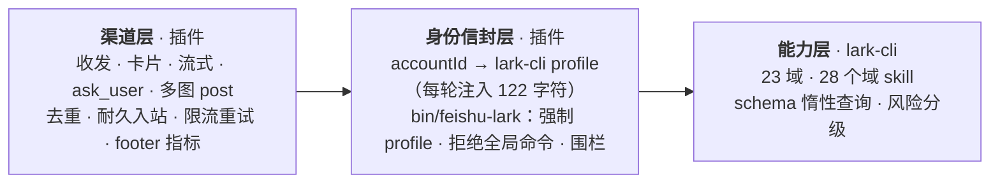

<h1 align="center">openclaw-lark-2</h1>

<p align="center"><b>飞书 / Lark 渠道插件 · OpenClaw 2.0 原生</b></p>

<p align="center">
  从飞书官方 <code>@larksuite/openclaw-lark</code> 分叉而来。上游停在 OpenClaw 1.x，我们把这条路走完，又往前推了一步：<br/>
  <b>原生 2.0 适配 · 23 个飞书域 · 一个网关同时服务多个飞书 bot。</b>
</p>

<p align="center"><sub>一句话：能力交给 lark-cli，身份与渠道留给插件。</sub></p>

<p align="center">
  
  
  
  
  
  
</p>

<p align="center"><sub><b>中文</b> · <a href="./README.en.md">English</a></sub></p>

## 重要通知

> [!IMPORTANT]
> **2026.10.10 是一次重大重构。** 从 2026.10.10 之前的版本升级的用户，请先读 [从 2026.10.10 之前的版本迁移](#从-20261010-之前的版本迁移) —— 含工具列表变更后的 capability consent 处理。

## 目录

- [三方对比](#三方对比)
- [富文本与交互按钮](#富文本与交互按钮)
- [架构](#架构)
- [快速开始](#快速开始)
- [配置](#配置)
- [从 2026.10.10 之前的版本迁移](#从-20261010-之前的版本迁移)
- [更新日志](#更新日志)

---

## 三方对比

| 维度 | **openclaw-lark-2**（本项目） | **@openclaw/feishu**（OpenClaw 官方） | **@larksuite/openclaw-lark**（飞书官方） |
|---|:---:|:---:|:---:|
| 来源 | 飞书官方 `@larksuite/openclaw-lark` 2026.7.16 的分支，重写为 2.0 原生 | OpenClaw 官方自研 | 飞书官方开源（2026.7.16 官方团队弃坑停止维护） |
| OpenClaw 2.0 兼容 | **✅ 原生 2.0 SDK** | ✅ 原生 2.0 | ❌ 1.x `loadConfig`，2.0 下无法加载 |
| 能力面（飞书操作） | **23 域（全自动对接 lark-cli）** | ~6 域 | 10 域 |
| 每轮工具开销 | **1 个工具 / 479 字符 ≈ 0.14k token** | 14 个工具 / ≈1.5–2 万字符 ≈ **4–6k token**（估） | 39 个工具 / ≈6.5–7 万字符 ≈ **18–21k token**（估） |
| 能力交付方式 | **CLI 按需调用 + 28 个域 skill** | 工具常驻 | 工具常驻 |
| 能力升级路径 | **插件与能力解耦，各自随时升级** | 随插件发版 | 随插件发版 |
| 多 bot / 多账号 | **✅ 插件 ↔ lark-cli 全链路：每账号绑定一个 profile，调用时强制带上** | ✅ `accountId` 参数 | ✅ 插件内 `accounts` 配置 |
| 身份错配防护 | **✅ 缺 profile 直接失败** | ⚠️ 依赖调用方传参 | ❌ |
| 用户授权（device flow） | **✅ 聊天内卡片 + `feishu_auth`** | ❌ | ✅ |
| exec 输出围栏 | **✅ 包装器统一** | — | — |
| 群聊流式卡片 | **✅** | ✅ | ❌ 默认 static |
| 多图合并 post | **✅ 默认** | ❌ | ❌ |
| `ask_user` 按钮卡片 | **✅** | ❌ | ❌ |
| 工具步骤展示 | **✅ 卡片内独立区块，默认开（不依赖 `/verbose`）** | ⚠️ 靠 `/verbose` 文本回显 | ⚠️ 靠 `/verbose` 文本回显 |
| 诊断 | **✅ `/feishu doctor`、`/feishu larkcli status`** | ✅ | ⚠️ |
| 测试 | **✅ 62 文件 / 495 用例** | ✅ 99 文件 / 1202 用例 | ❌ 无 |

> [!NOTE]
> token 数为每轮注入的工具 schema 体量：本插件为实测（`scripts/check-tools.js`），官方两家按工具数与参数定义体量估算（每工具 ≈1–1.8 KB schema）。能力面之外的渠道差异另见下表注释。

### 详细说明

#### OpenClaw 2.0 兼容

上游停在 1.x 的 `loadConfig` 插件 API；2.0 换了插件模型，所以上游代码在 2.0 下**无法加载**。本项目是原生 2.0 实现，不只是"能跑"：

| 2.0 机制 | 本项目用法 |
|---|---|
| 插件入口 | `register()` + `runtime.config.current()` |
| 工具 / 命令 | `registerTool`、`registerCommand` |
| 每轮上下文 | `agentPrompt.inboundFormattingHints({cfg, accountId})`（`alwaysActive` 在 2.0 是无效字段） |
| 渠道消息动作 | 实现 `feishuMessageActions`，接入核心 `message` 工具 |
| 卡片交互 | `card.action.trigger` 全链路（`ask_user` 按钮、inject_prompt） |
| 宿主原语 | 直接使用 `plugin-sdk/*`（10.2 起 344 个子路径）：durable ingress、thread bindings、webhook、retry |

#### 能力面

本项目的 23 个域来自 lark-cli：docs / sheets / base / drive / im / task / calendar / wiki / contact / approval / mail / minutes / vc / okr / slides / whiteboard / markdown / mindnotes / note / event / attendance / apps / application，并自带 28 个域 skill 按需加载。OpenClaw 官方插件 14 个工具覆盖 doc / drive / wiki / chat / perm / bitable，**没有 calendar、task、sheets**。

渠道侧同样不是同一档：

| 渠道能力 | 本项目 | `@openclaw/feishu` |
|---|---|---|
| 入站消息转换器 | **22 种** | 部分 |
| 群聊流式卡片 | **✅ `replyMode.group:"streaming"`** | ✅ |
| 多图合并成一条 post | **✅ 默认** | ❌ 逐张 |
| `ask_user` 按钮卡片 | **✅ 按钮 + "其他答案" + 群聊全员可交互** | ❌ 文本回退 |
| 工具步骤动态展示 | **✅ 卡片内独立区块，默认开** | ⚠️ 仅 `/verbose` / preview 文本回显 |
| 持久化入站队列 | **✅ 可选（`durableIngress`）** | ✅ 默认开 |
| 全量出站 SSRF 防护 | **✅ DNS pinning + 私网阻断 + 重定向校验** | ✅ 仅 CardKit / 注册 |

#### 多 bot / 多账号

lark-cli 是**单 profile** 的：`profile use` 切换的是进程级全局状态，一次只能当一个飞书应用。所以"一个网关同时服务多个飞书 bot（不同 app）"单靠 lark-cli 做不到。本项目补了三层：

1. 账号 ↔ profile **按调用选择**（`--profile <账号>`，不是全局切换）；
2. 每轮把"这条消息属于哪个账号"注入上下文（122 字符），模型不需要猜；
3. `bin/feishu-lark` 在命令行层强制：缺 `--profile` 直接失败、拒绝 `profile use` 等全局命令、stdout 统一围栏。

#### 能力升级路径

能力在 CLI 侧：新增域和命令随 lark-cli 自身升级即可用；插件侧只在渠道与身份逻辑变化时更新。**两者解耦，谁也不用等谁发版。**

---

## 富文本与交互按钮

OpenClaw 核心有一套**渠道无关**的富文本协议 `MessagePresentation`：`/status` 会产出一个 `table` 区块（"Session status" 两列表格），审批、`ask_user`、provider 登录会产出 `buttons` 区块。核心按渠道声明的 `presentationCapabilities` 把这些区块适配一次，再交给渠道的 `renderPresentation` 钩子渲染；**渠道不声明能力，核心就把它们全部降级成纯文本**。

本插件声明并实现了这套协议，所以飞书里看到的和 Telegram 里一致：

| 可移植区块 | 飞书卡片元素 |
|---|---|
| `text` | `markdown` |
| `context` | `markdown`（`text_size: notation`，弱化显示） |
| `divider` | `hr` |
| `table` | `markdown`（内嵌 GFM 表格，飞书原生渲染成表格） |
| `buttons` | `column_set` → `column` → `button` |
| `select` | 同上，每个选项一个按钮（飞书没有原生菜单控件） |
| `chart` | 不支持原生图表，由核心降级成文本 |

涉及的模块：

- `src/card/presentation-card.js` —— 可移植区块 → 飞书卡片 JSON 2.0（纯函数，可单测）。
- `src/card/presentation-delivery.js` —— 回复载荷 → 卡片 + 随附文本。
- `src/messaging/outbound/outbound.js` —— 声明 `presentationCapabilities` 与 `renderPresentation`。

### 命令参数菜单

`/verbose`、`/think`、`/fast`、`/reasoning` 这类命令的**候选项由核心定义**（`commands-registry`），渠道只负责渲染。Telegram 用 inline keyboard 渲染；飞书没有原生命令注册，所以插件在入站时解析命令、解析出候选菜单，渲染成一张卡片：

- 每个按钮的 `value` 是 `{ action: "inject_prompt", prompt: "/verbose on" }`；
- 点击后按钮把该命令文本当作一条用户消息注入，走正常命令链路（`src/channel/event-handlers.js` 的 `handleInjectPromptAction`）；
- 因此权限、审计、持久化全部沿用核心原有路径，插件不持有任何命令状态。

模块：`src/channel/command-menu.js`。

### 模型选择器

核心驱动模型选择器，通过 `ChannelCommandAdapter` 钩子向渠道索取按钮。本插件实现了全部 5 个钩子（`src/channel/model-menu.js`），按钮同样走 `inject_prompt`：

| 按钮 | 注入的命令 |
|---|---|
| Browse providers | `/models providers` |
| 某个 provider | `/models <provider>` |
| 某个 model | `/model <provider>/<model> -s`（会话级，与 Telegram 选择器的作用域一致） |
| 翻页 | `/models <provider> <page>` |

---

## 架构



---

## 快速开始

**前置条件**：OpenClaw ≥ 2026.8.1；`lark-cli`（`npm i -g @larksuite/cli`）；agent 有 exec 权限。

```bash
# 1. 安装插件
openclaw plugins install clawhub:@mirr0ch1/openclaw-lark-2 --accept-capabilities

# 2. 配置飞书应用（单账号最小配置）
openclaw config set channels.feishu.appId cli_xxx
openclaw config set channels.feishu.appSecret xxx

# 3. 在飞书里同步账号 → lark-cli profile（幂等，自动沿用已有 profile）
#    /feishu larkcli sync

# 4. 体检
#    /feishu larkcli status   → 每个账号的 profile / appId / token 状态
#    /feishu doctor           → 渠道 + 权限 + 连通性
```

装完插件后 agent 自带三个 skill：`feishu-cli`（业务入口与身份约定）、`feishu-channel-rules`（飞书输出格式）、`feishu-troubleshoot`（排障）。

---

## 配置

### 多 bot / 多账号

```jsonc
{
  "channels": {
    "feishu": {
      "appId": "cli_main",          // 默认账号（也可用 accounts.default）
      "appSecret": "xxx",
      "accounts": {
        "plaud":     { "appId": "cli_a", "appSecret": "xxx" },
        "hdwriting": { "appId": "cli_b", "appSecret": "xxx" }
      },
      "larkCli": {
        "enabled": "auto",          // auto（默认，检测到 lark-cli 才启用）| true | false
        "prompt": "minimal",        // minimal（默认）| compact | full | off
        "binaryPath": ""            // 可选，显式指定 lark-cli 路径
      }
    }
  }
}
```

> [!NOTE]
> 账号 id 就是 lark-cli 的 profile 名。若该 appId 已被 `config bind` 绑成别的 profile 名，插件会自动沿用已有名字（lark-cli 不允许一个 appId 两个 profile）。

### `larkCli.prompt` 四档

| 值 | 每轮注入 | 适合 |
|---|---|---|
| `minimal`（默认） | 122 字符：当前 profile + 包装器路径 | 绝大多数场景 |
| `compact` | + 其他账号清单 + 禁止项 | 多 bot、希望模型主动区分 |
| `full` | + 授权流程 + 根/域命令规则 | 调试期 |
| `off` | 0 | **仅单账号**（包装器会自动采用唯一 profile） |

---

## 从 2026.10.10 之前的版本迁移

2026.10.10 把注册工具从 38 个收敛到 1 个（`feishu_auth`），业务能力改由 lark-cli 承担。升级后有两件事要做。

### 1. 处理 capability consent 警告

插件声明的能力面变了（工具列表 38 → 1），OpenClaw 会要求重新确认。看到下面这条时：

```text
Plugin "openclaw-lark-2" requires capability consent; disable and re-enable it
or run: openclaw plugins enable openclaw-lark-2 --accept-capabilities
```

执行一次确认即可：

```bash
openclaw plugins enable openclaw-lark-2 --accept-capabilities
```

在飞书里也可以：`/plugins enable openclaw-lark-2 --accept-capabilities`。

- **ClawHub / npm 安装**：安装记录带完整性校验，升级时可以直接 `openclaw plugins update openclaw-lark-2 --accept-capabilities` 一步完成。
- **本地目录 / 压缩包安装**：没有完整性记录，OpenClaw 无法证明新字节就是你确认过的那份，**每次替换都要重新确认**。

### 2. 清掉残留的工具白名单

`agents.*.tools.alsoAllow` 里指向已下线工具的 `feishu_*` 条目删掉（`tools.deny` 里的留着无害）。否则这些名字既不存在也永远匹配不上。

### 3. 工具去哪了

| 原工具 | 现在怎么做 |
|---|---|
| `feishu_create_doc` / `fetch_doc` / `update_doc` | `feishu-lark --profile <p> docs +create / +fetch / +update` |
| `feishu_bitable_*` / `calendar_*` / `task_*` | `feishu-lark … base / calendar / task …` |
| `feishu_im_user_*` | `feishu-lark … im +messages-search / +chat-messages-list` |
| `feishu_im_user_message` | `feishu-lark … im +messages-send`（bot 身份也可用核心 `message` 工具） |
| `feishu_drive_file` / `sheet` / `wiki_*` / `get_user` / `chat*` | `feishu-lark … drive / sheets / wiki / contact / im …` |
| `feishu_oauth` / `oauth_batch_auth` | **`feishu_auth`**（唯一保留的工具） |

模型不需要你教它这些：`feishu-cli` skill 里有路由表，命令细节用 `lark-cli <域> --help` 或 `lark-cli skills read lark-<域>` 按需取。

---

## 更新日志

<details open>
<summary><b>2026.10.14</b> · 2026-10-27 · 评审修复：出站载荷不再丢媒体/回复目标，入站路径补上核心能力适配</summary>

独立评审在 2026.10.13 基础上发现 4 个问题，都已修复并加了回归用例。

- **出站载荷被整体替换（P0）**：`renderPresentation` 钩子原本返回一个新对象，而核心是"用钩子的返回值替换整个载荷"（`withoutPresentation` 只剥掉 `presentation`，不会把原载荷合回来）。于是带 presentation 的出站载荷会**丢掉 `mediaUrls` / `replyToId` / `location` / 其它 channelData**。现在改为合并回原载荷。
- **`presentationTextMode` 在出站路径被一刀切丢弃（P2）**：只有当文本就是 presentation 的降级副本（`"fallback"`）时才丢弃；否则文本是额外内容，必须保留。
- **入站路径绕过了核心的能力适配（P1）**：三条入站路径直接渲染 presentation，没跑 `adaptMessagePresentationForChannel`，于是：图表被**整块丢掉**（应当降级为文本）、`disabled` 按钮被渲染成**可点的活按钮**、`limits.text.maxLength` / `maxLabelLength` / `maxActions` 全部未生效。现在入站路径也走核心适配。
- **表格预算只数了 `table` 区块（P1）**：飞书限制的是**渲染出来的** markdown 表格，文本区块里自带的表格也算。现在文本区块里的表格同样计入预算，超出的降级为代码块（与插件既有的 `sanitizeTextForCard` 行为一致）。
- **`web-app` 动作丢掉链接（P2）**：带 URL 的 `web-app` 现在和普通 `url` 一样渲染为可点击链接。

**测试**：新增 3 个测试文件 / 9 个用例；全量 **68 文件 / 547 用例** 通过。

</details>

<details open>
<summary><b>2026.10.13</b> · 2026-10-27 · 富文本与交互按钮：/status 出表格，/verbose 出按钮</summary>

之前飞书渠道只有纯文本和 `ask_user` 卡片，因为插件没有声明 OpenClaw 的**可移植富文本协议**（`MessagePresentation`）能力，核心在投递前就把所有 `table` / `buttons` 区块降级成了文本。这次把协议接上了。

**可移植富文本**

- 声明 `presentationCapabilities`（`tables` / `buttons` / `selects` / `context` / `divider` 开启，`charts` 关闭由核心降级）并实现 `renderPresentation`。
- 新增 `src/card/presentation-card.js`：可移植区块 → 飞书卡片 JSON 2.0。`table` 渲染成卡片内的 GFM 表格（飞书原生渲染成表格），`buttons` / `select` 渲染成 `column_set` → `column` → `button`（v2 没有 v1 的 `action` 包装）。
- 新增 `src/card/presentation-delivery.js`：回复载荷 → 卡片 + 随附文本；当载荷带 `presentationTextMode: "fallback"`（文本就是展示的降级副本）时不再重复发送文本。
- 三个投递入口都接上了：核心出站 `sendPayload`、入站命令回复（`/status` 走这里）、入站 agent 回复（审批 / provider 登录按钮走这里）。
- 代码自建的卡片走 `channelData.feishu.nativeCard`，不经过面向模型生成卡片的清洗器，因此保留完整元素保真度。

**命令参数菜单**

- 新增 `src/channel/command-menu.js`：用核心的 `commands-registry` 解析 `/verbose`、`/think`、`/fast` 等命令的候选菜单，渲染成卡片。
- 按钮的 `value` 是 `{ action: "inject_prompt", prompt: "/verbose on" }`，点击后把命令文本当作用户消息注入 —— 复用插件已有的 `inject_prompt` 机制，不新增任何命令状态，权限与审计仍走核心原有路径。
- 只对**有命令权限**的发送者显示；已在参数菜单里的命令（如 `/verbose on`）不再弹菜单。

**模型选择器**

- 新增 `src/channel/model-menu.js`，实现核心 `ChannelCommandAdapter` 的 5 个模型选择器钩子（`/model`、`/models` 的按钮来源）。按钮同样走 `inject_prompt`，模型选择由核心自己执行（`/model <provider>/<model> -s`，会话级作用域，与 Telegram 选择器一致）。

**测试**

- 新增 5 个测试文件（可移植区块 → 卡片、载荷 → 卡片解析、命令参数菜单、模型选择器、未定义标识符守卫），共 40 个用例；全量 **67 文件 / 538 用例** 通过。

**回归修复**

- 修了本轮自己引入的一个事故：命令菜单代码块引用了 `effectiveSessionKey` —— 那是 `dispatchNormalMessage` / `dispatchCommentMessage` / `dispatchSyntheticMessage` 的局部变量，不是 `dispatchToAgent` 的。于是**每一条命令消息**（`/status` `/stop` `/verbose` …）在派发前就抛 `ReferenceError`，飞书里既没有回复也没有错误提示；普通消息因为没走到那行，看起来"正常"。现在按其他派发路径的同一写法取会话键：`dc.threadSessionKey ?? dc.route.sessionKey`。
- 新增 `scripts/check-undef.js` + `tests/channel/no-undefined-identifiers.test.ts`：用 `tsc --checkJs` 只挑"未定义标识符"一类诊断（TS2304 等）扫全部 `src/**/*.js`，把这类事故挡在编译期。已用事故版本验证过它会红。
- 新增 `scripts/link-openclaw.js` + `postinstall`：`npm install` 会删掉手工建的 `node_modules/openclaw` 符号链接（openclaw 是宿主程序本身，不是 npm 依赖），导致 `require('openclaw/plugin-sdk/...')` 全线失败。钩子负责补回。
- 卡片发送失败不再吞掉回复：系统命令回复回落到纯文本；agent 回复回落到可见文本；命令菜单回落成"照常执行该命令"。

</details>

<details open>
<summary><b>2026.10.11</b> · 2026-10-25 · 文档修正：三方对比与英文表述</summary>

无代码变更。修正 README 里的描述错误，并把中英两版重新接上：

- 三方对比「多 bot / 多账号」：`@larksuite/openclaw-lark` 其实**是支持的**（插件内 `accounts` 配置），此前误标为 ❌；本项目的差别只在「账号 ↔ lark-cli profile 全链路绑定、每次调用强制带上」。
- 三方对比「工具步骤展示」：原来两列只写 `verbose`，看不出差别。改为说明 —— 本项目是**卡片内独立区块、默认开**；官方两家靠 `/verbose` 的文本回显。
- 英文版把 "fork of Feishu 7.16" 写清为 `@larksuite/openclaw-lark` 2026.7.16，避免与 OpenClaw 内置的 `@openclaw/feishu` 混淆。
- 补回中英互链（`中文 · English`）；徽章与对比表的用例数同步为 **62 文件 / 495 用例**。

</details>

<details>
<summary><b>2026.10.10</b> · 2026-10-25 · 大重构：工具面 38 → 1，业务能力委派 lark-cli</summary>

这次不再"加功能"，而是重新划边界：**插件负责渠道与身份，lark-cli 负责业务能力。**

**工具面（破坏性变更）**

- 注册工具 **38 → 1**：只保留 `feishu_auth`（聊天内 device-flow 授权）。下线 37 个：doc×3（连带整条远程 MCP 传输）、bitable×5、calendar×4、task×7、im 读取×3、文档搜索×1、drive×3、sheets×1、wiki×2、contact×2、chat×2、media×2、`im_user_message`、`oauth`、`oauth_batch_auth`。
- 每轮工具 schema **67,206 → 479 字符**（−99.3%）；`src/tools` **12,098 → 662 行**（−94%）。
- `openclaw.plugin.json` 的 `contracts.tools` / `toolMetadata` 按实跑注册重算；`TOOL_SCOPES` 清空（渠道自身的 `REQUIRED_APP_SCOPES` 保留）。

**身份信封（新增）**

- `bin/feishu-lark`：按调用强制 `--profile`（缺了直接失败；单 profile 安装自动采用）、拒绝 `profile use/add/remove`、`config bind`、`lark-cli update` 等进程级命令、默认把 stdout 包成 `EXTERNAL_UNTRUSTED_CONTENT`（`--no-fence` 供 jq/python 解析）。
- `src/larkcli/profiles.js`：账号 ↔ profile 映射（appId 优先解析、沿用已有绑定名）、`provisionProfiles`（幂等、secret 走 stdin、改前备份、凭证自愈）、`healthCheck`（能发现 appId 漂移）。
- `inboundFormattingHints` 每轮注入身份：`minimal`（默认，122 字符）/ `compact` / `full` / `off` 四档。

**授权**

- 插件自建 UAT 栈（`oauth` / `auto-auth` / `oauth-cards` / `onboarding-auth` / `device-flow` / `token-store` / `uat-client`）整体移除；`/feishu auth` 改为授权流程指引，`/feishu doctor` 的用户授权段改报 lark-cli profile 状态。
- 新增 `feishu_auth`：`authorize` 生成授权链接并发送按钮卡片 → `complete` 用 `--device-code` 收尾；`status` / `revoke` 对应 `auth status` / `auth logout`。

**Skill**

- 8 → 3：新增 `feishu-cli`（身份约定 + 域路由表 + 高风险/跨会话读取硬规则 + 输出解析），删除 5 个薄指针。

**配置**

- 新增 `channels.feishu.larkCli`（`enabled` / `prompt` / `binaryPath`）；移除随 MCP 传输下线的 `mcpEndpoint` / `mcp_url`。

**SDK 弃用适配**

- 会话级 `/verbose` 覆盖改走异步读 `getSessionEntryAsync`（同步 `getSessionEntry` 兼容至 2026-12-31，2027 年 1 月首个 stable 版本移除）；内联 `/verbose` 直接短路、不再读会话库；老 core 缺异步读时按「无会话覆盖」回落配置默认值。
- 会话绑定管理器改为 **V2 优先**（`createAccountScopedConversationBindingManagerV2`：worker 异步读写 + 当前来源断言）。`< 2026.10.10` 的 core 没有 V2，回落到旧工厂并只打一条 debug 日志；该兜底会在 peer 底线抬到 10.10 后删除。
- 行为与存储格式不变，只有读写路径迁移。发布后 ClawHub 弃用审计的 session 一条应清零；bindings 一条会保留到兜底删除为止。

**测试与自检**

- `scripts/check-tools.js` 第三层改为 CLI 委派冒烟（二进制、包装器、每账号 profile 健康）。
- **62 文件 / 495 用例**（含本轮新增的 tool-use 解析用例与双代管理器兼容用例）。

</details>

<details>
<summary><b>2026.10.9</b> · 2026-10-15 · 死代码清理</summary>

移除 15 个在 `src/`、`tests/`、`index.js` 中零引用的导出（-151 行）：卡片 trace 的 `hasToolUseTraceRun` / `_resetForTesting`，`read-policy` 的 `canEnumerateAllFeishuGroups`，`shutdown-hooks` 的 `_resetShutdownHooks`，`tool-scopes` 的 `REQUIRED_SCOPE_DESCRIPTIONS`，`bot-loop-guard` 的 `resetAllBotLoops` / `botLoopStateSize`，`sentinel-store` 的 `clearSentinelStore`（及其连带的 `clearAllSentinelStores`），`time-utils` 的 `secondsStringToDateTime` / `dateTimeToMillis`（及连带的 `secondsToDateTime`），以及 `security-check` 中**已停用的多账号隔离特性**的辅助函数 `generateIsolationFixCommands` / `generateSharedAgentCommands`（及连带的 `getDmScopeFixCommand`）—— 已接线的空实现 `collectIsolationWarnings` / `emitSecurityWarnings` 保留。

保留 `CARD_PHASES`：它并非死代码，导出的 `CardPhase` 类型由 `typeof CARD_PHASES` 派生。同步删除对应 `.d.ts` 声明。

**测试**：**59 文件 / 450 用例**。

</details>

<details>
<summary><b>2026.10.8</b> · 2026-10-15 · 可靠性加固（对比官方逐项对齐）+ 入站 debounce 合并</summary>

以官方 `@openclaw/feishu` 为参照，对插件自身代码做了一轮系统的健壮性加固（A / B / C 三批 + 若干修复），并移植入站 debounce 合并。

**可靠性修复（A 批 / S1）**

- **webhook 崩溃**：修复 webhook 路径上的 `ReferenceError`。
- **出站 code 断言**：出站错误码断言不再误判。
- **流式配置**：`streaming` 配置 schema 与运行时对齐。
- **多账号 / 目标解析**：accounts 与 targets 解析修复（含 `lark:` / `group:` / `channel:` / `dm:` 前缀与 tag 感知）。
- **pending-history key**：群聊待处理历史键对齐官方 `groupHistoryKey`（去掉 `:thread:` 后缀）——修复 `threadSession` 下「root_id 推断线程」导致历史桶读写不一致、上下文被静默丢弃的问题。

**可靠性修复（B 批）**

- **reaction 访问门禁**：reaction 事件在派发前补上访问门禁校验（安全）。
- **撤回回复回退**：回复目标已撤回时自动回退为新建消息（对齐官方 `sendReplyOrFallbackDirect`）。
- **groupSessionScope 入站落地**：`group` / `group_sender` / `group_topic` / `group_topic_sender` 会话作用域在入站生效。
- **交互去重键**：卡片交互按 `event_id` / `token` 去重（重试稳定）。
- **abort 快路径键**：中断快路径的队列键与派发键对齐。

**可靠性修复（C 批）**

- **`onDeliveryResult` 透传**：出站适配器把每次物理发送的结果回传给核心（部分投递 / 子代理完成追踪）；回调异常只记日志，不影响已发送结果。
- **去重持久化**：入站去重改用宿主 `openclaw/plugin-sdk/persistent-dedupe`（SQLite）并采用 **claim / commit / release** 语义 —— 重启不再重复处理；commit 在「消息入队 / 采纳之后」，崩溃不会永久吞掉重投递。TTL 对齐官方 24h。
- **mention 注册表上限**：name→openId 注册表按「每群 500 / 全局 500」双向封顶（LRU 刷新），不再无界增长。
- **出站媒体上限 + 失败传播**：出站媒体强制 `min(mediaMaxMb, 30MB)`（远端流式读取超限即中止，内存有界）；`mediaMaxMb` schema 要求正数；直接 `send` 附件上传失败改为显式报错（#112244），渠道级回复仍保留文本链接降级。

**入站 debounce 合并（P3-A6，可选）**

- 核心配置 `messages.inbound.debounceMs`（默认 0 = 关）。开启后，同一 `(账号 / 会话 / 话题 / 发送者)` 在安静窗口内的连续**文本**消息合并为**一条**再触发一次 agent 回合（控制命令不合并），减少刷屏并让上下文更完整。
- 与 `durableIngress` 联动：按 `event_id` 把耐久入站行的生命周期传给处理器，flush 完成前不墓碑化 —— **debounce 窗口内崩溃也不丢消息**（对齐官方 `buildFeishuFlushIngressLifecycle`）。

**最终复核（对齐官方 main `c36af74`）**

- **`replyInThread` 配置类型**：schema 与运行时不一致（schema 为 boolean，运行时按官方字符串枚举 `"enabled"` 比较），导致布尔 `true` 静默失效、官方写法 `"enabled"` 校验失败。现同时接受两者并统一归一化。
- **allowlist 前缀**：`feishu:` / `lark:` / `user:` / `open_id:` 等前缀条目此前被静默拒绝，现按官方归一化。
- **`@all` 识别**：放宽为官方的 `@all` / `@_all` 键 + `id.* === "all"`（原先仅 `@_all`）。
- **reaction / 文档评论派发**：补上 `botOpenId`（此前群系统提示 / 身份字段 / bot-peer 提及解析为空）。
- **媒体回退链接**：上传失败回退为文本链接前先做 SSRF 校验（仅公网 http(s) 才回显，否则发通用失败提示），对齐官方 `resolvePublicFeishuMediaReference`。
- **移除死代码**：删除从未接入且宿主已移除 `OnboardingAdapter` 契约的 onboarding 适配器（3 模块）与 `agent-config` 模块。

**测试**：30 文件 / 226 用例 → **59 文件 / 448 用例**。

</details>

<details>
<summary><b>2026.10.6</b> · 2026-10-14 · 诊断 hook 加固：绝不 fail-close 工具链路</summary>

`before_tool_call` 在 OpenClaw 中是 **fail-closed**：插件 hook 一旦抛异常，**整个工具调用**会被阻断 —— 而且**不区分工具**。本插件的这两个 hook 只做调用追踪与日志，不该具备这种破坏力。

**修复**

- `before_tool_call` / `after_tool_call` 两个诊断 hook 现在**整段包 `try/catch`**：任何异常降级为一条 `log.warn` 并放行，**永不阻断工具调用**。
- hook 事件字段全部防御式读取（`event?.toolName ?? ''`、`ctx?.sessionKey`），对宿主契约变化免疫。

**排查提示**

> 热更新插件（`plugins install` / `plugins reload`）后，若**所有** cron / 无头任务的工具调用被阻断，且日志出现
> `before_tool_call hook failed: … PluginInstanceUnavailableError: Plugin openclaw-lark-2 was reloaded or disabled; use its current tools.`
> —— 那是宿主在 **drain 超时**后残留了**上一代插件实例的 hook**，与本插件的代码无关。
> 执行 `openclaw plugins reload openclaw-lark-2` 清除（无效时重启网关）；交互会话通常不受影响。

**测试**：30 文件 / 226 用例。

</details>

<details>
<summary><b>2026.10.5</b> · 2026-10-14 · 对齐官方 <code>@openclaw/feishu</code>：可靠性原语 · 读权限 · 多账号路由</summary>

以官方插件（openclaw `main` `2f620b9`，2026-10-12）为参照，移植其更成熟的工程原语，并补齐多账号与读权限。**新能力多为可选或对既有行为无影响**，其中读权限是唯一的有意收紧。

**可靠性**

- **工具结果围栏 + 结构化错误**：模型可见输出统一包 `EXTERNAL_UNTRUSTED_CONTENT`，错误附带 `http_status`/`feishu_code`/`feishu_msg`/`feishu_log_id`。
- **发送限流统一重试**：429 与 `230020`/`11232`（含"200 但 body 是限流码"），覆盖全部 IM 发送点。
- **每会话队列超时**：单条 dispatch 默认 5 分钟上限，超时不再阻塞同会话后续（#70133）。
- **重投递稳定去重**：text/post 按 `sender+chat+create_time+内容哈希`（#46778）。
- **原生卡消毒**：元素白名单 + 按钮 URL 仅 http(s) + callback value 门禁 + 文本转义（仅作用于模型自建卡）。
- **探针错误缓存 1 分钟 + 目录分页护栏**；**富文本 post 按 30KB 序列化字节自适应切分**。

**传输与投递**

- **Webhook 传输**（`connectionMode: "webhook"`，可选）：签名校验 + 时间偏移上限 + challenge 应答 + 请求体/并发前置守卫。
- **持久化入站队列**（`durableIngress: true`，默认关）：宿主队列 + 按会话 lane 保序 + 可重试/永久错误分类。
- **发送权威**：被 retire/abort 的回合在发送前抛 `PlatformMessageNotDispatchedError`（`retryable:false`），不再发出陈旧消息。

**多账号与读权限**

- **按调用指定账号**：全部工具支持可选 `accountId`；显式账号未配置/被禁用会明确报错，不再静默回退到首个账号。
- **读权限策略**（对齐官方）：`feishu_chat.get` / `feishu_chat_members` 受策略约束 —— 当前会话可读；跨群按 `groupPolicy`；**跨私聊需 `allowFrom` 含 `*`**。
- **配置信号**：manifest `toolMetadata.configSignals`，未配置凭据时按工具隐藏。

**其他**

- **文档评论 typing 反应**：评论事件没有 IM 消息可挂"输入中"指示，改为在评论回复上加 `Typing` 反应、回合结束后移除（`typingIndicator: false` 可关）。
- **`openclaw doctor --fix` 配置修复**：新增包根 `doctor-contract-api`，可自动把 `channels.feishu[.accounts.<id>].webhookPath` 规范化（命名账号按账号派生路径，避免与默认账号撞路由）。

**修复**：`config-schema` 补齐 `durableIngress` / `defaultAccount` / `typingIndicator`；修掉 `config-schema.d.ts` 里 `accounts` 形态重复的 `multiImageMode`；`.d.ts` 与运行时同步。

**测试**：15 文件 / 128 用例 → **30 文件 / 226 用例**；`clawhub package validate` 通过。

</details>

<details>
<summary><b>2026.10.3</b> · 2026-10-03 · 内置 Skills 重构为 lark-cli 薄指针 + 渠道格式规则常驻</summary>

内置 skill 收敛为 3 个（`feishu-cli` 路由 / `feishu-channel-rules` 输出格式 / `feishu-troubleshoot` 排障），业务域用法改为按需 `lark-cli skills read lark-<域>`。早期以 `lark-cli` 为唯一操作入口的重构：`feishu-create-doc` / `feishu-fetch-doc` / `feishu-update-doc` 合并为 `feishu-doc`（原三者引用的 `feishu_mcp_*` 工具名早已失效）；`feishu-bitable` / `feishu-calendar` / `feishu-im-read` / `feishu-task` 改为指向对应 `lark-cli <domain>` 与官方 `lark-*` skill，仅保留渠道特有知识。新增「lark-cli 缺失」兜底提示（引导安装 `@larksuite/cli`，而非回退已停用工具）。修复 `feishu-channel-rules` 的失效 `alwaysActive` 字段——改为通过 `agentPrompt.inboundFormattingHints` **每轮注入** Lark 卡片格式规则；更正标题自动降级、图片 URL 自动转 key 两处过时说明。skill 体积 4803 → 538 行。（15 文件 / 128 用例）

</details>

<details>
<summary><b>2026.10.2</b> · 2026-10-03 · 文档：README 拆分为中文（默认）与英文</summary>

README 拆为两个文件：`README.md`（中文，默认）与 `README.en.md`（English）；修正 ClawHub 安装命令为 `openclaw plugins install clawhub:@mirr0ch1/openclaw-lark-2`。无代码变更。

</details>

<details>
<summary><b>2026.9.20</b> · 2026-10-03 · 修复默认账号下群聊命令被判未授权</summary>

`getLarkAccount` 当 `accountId === 'default'` 时会整个跳过 `accounts.default` 覆盖，导致写在该账号条目里的 `allowFrom / groupAllowFrom / dmPolicy / groupPolicy` 被丢弃（core 的 `resolveFallbackAccountConfig` 会读这些字段，插件不读 → 两边解释不一致）。私聊靠 pairing allow-from store 兜住所以正常；群聊不读 store 又丢了 `groupAllowFrom` → 插件算出 `CommandAuthorized=false`，于是 `/new`、`/reset` 等 owner 级命令被 core 静默拒绝（`Ignoring /new from unauthorized sender`），不 reset 也不产生可见回复，只回通用兜底文案。现在 default 账号的显式覆盖会像其它账号一样被合并。新增 6 条账号回归测试（14 文件 / 126 用例）。

</details>

<details>
<summary><b>2026.9.19</b> · 2026-09-19 · 修复长任务回复丢失</summary>

终端卡片整卡更新撞飞书硬上限（>200 元素 300305 / >30KB 200860）时失败被吞，用户只看到卡住的流式卡片（实测 61 次工具调用 → 310 元素）；现在终端卡片按硬上限自适应降级（工具步骤折叠为“其余 N 步未展示”、reasoning 面板裁切/丢弃、工具输出截断、必要时裁正文），并在**卡片更新失败或正文被裁切时自动以纯文本补发完整回复**。另：流式模式被飞书 10 分钟上限自动关闭（300309）后不再静默丢消息（原“回退 `im.message.patch`”对 CardKit 卡片是空操作）。新增 17 条卡片预算/兜底单测（13 文件 / 120 用例）。

</details>

<details>
<summary><b>2026.9.6</b> · 2026-09-06 · 修复多账号入站消息静默丢弃</summary>

修复 OpenClaw 2.0 多账号下入站消息全部静默丢弃（`PreparedModelCatalogConfigReplacedError`）：核心调度改用未被篡改的全局 config + `usePublishedModelRuntime`（PR #1，by leothebravest）；补齐 comment / reaction / VC 邀请三条链路的 config 透传，并阻断 `config.current()` 返回空对象导致的 `cfg: {}` 派发；新增 6 条派发配置单测（11 文件 / 103 用例）。

</details>

<details>
<summary><b>2026.9.4</b> · 2026-09-03 · 多图合并为一条富文本 post</summary>

新增 `channels.feishu.multiImageMode`（默认 `post`，`sequential` 回退逐张；任一上传失败自动回退）。（10 文件 / 97 用例）

</details>

<details>
<summary><b>2026.9.3</b> · 2026-09-02 · SSRF 防护 · PIN 操作 · 测试基座</summary>

SSRF 防护全量落地、PIN 消息操作、vitest 测试基座（9 文件 / 78 用例），全量安全测试通过。

</details>

<details>
<summary><b>2026.9.2</b> · 2026-09-01 · ask_user 修复 · 群聊流式</summary>

修复 ask_user “其他答案”提交；移除 `feishu_ask_user_question`；群聊流式卡片；工具 dry-run 脚本。

</details>

<details>
<summary><b>2026.9.1</b> · 2026-09-01 · OpenClaw 2.0 兼容修复</summary>

OpenClaw 2.0 兼容修复、内置 ask_user 按钮渲染、工具动态展示、ClawHub 发布。

</details>

<details>
<summary><b>2026.8.1</b> · 2026-08-31 · 初始 2.0 适配分支</summary>

初始 2.0 适配分支。

</details>

---

## 开发

```bash
npm install            # 安装依赖（含 vitest）
npm test               # 运行 vitest 测试套件
npm run test:watch     # 测试监听模式
```

插件为 CommonJS 源码（`src/` + `index.js` 入口），无构建步骤；改动后同步到 OpenClaw 扩展目录并重启网关即可生效。

---

## 致谢与许可

基于 [larksuite/openclaw-lark](https://github.com/larksuite/openclaw-lark)（MIT）二次开发，保留 MIT 许可。

<div align="center"><sub>openclaw-lark-2 · OpenClaw 2.0 · 飞书 / Lark</sub></div>
